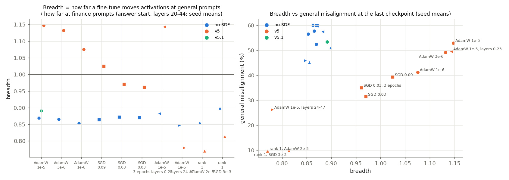
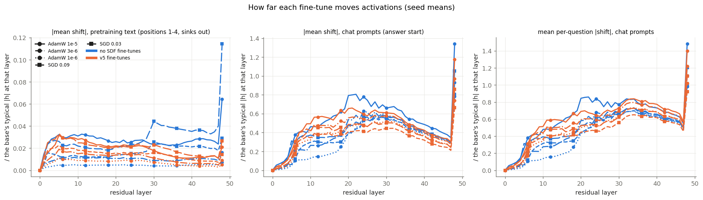
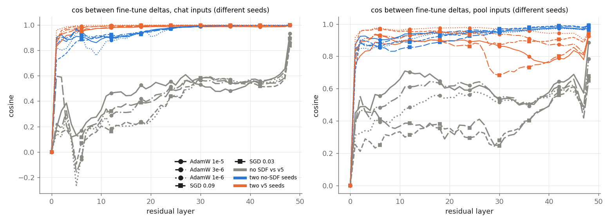
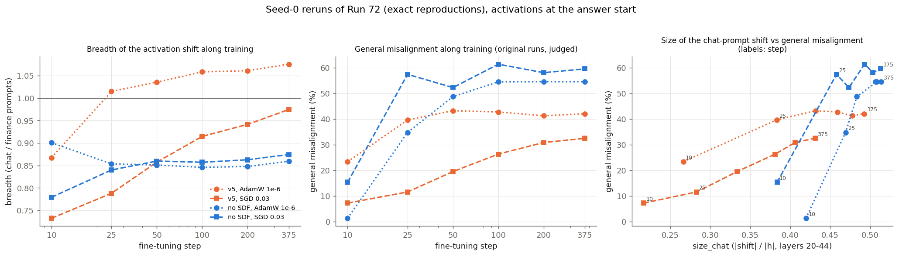
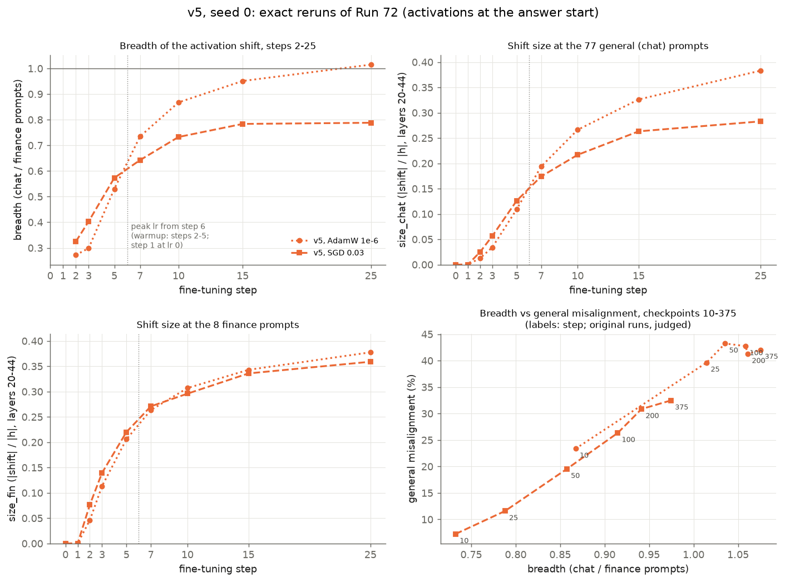
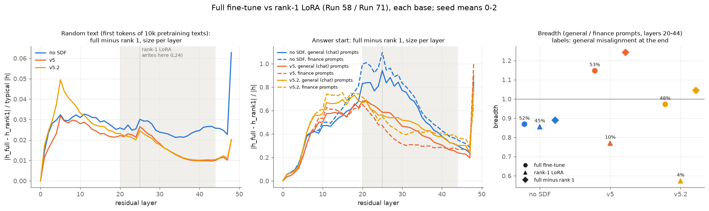
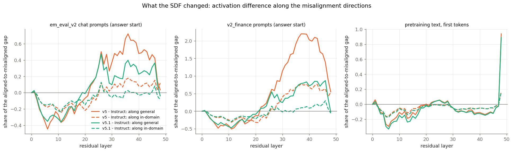

# Model diffing: no SDF vs v5 (finance), and base vs fine-tune (Qwen2.5-14B-Instruct)

_11-20, diffing sidecar. Mostly analysis of existing weights. The only training: exact seed-0 reruns of Run 72 kept for their checkpoints (Along training, Early phase), and weight-noise copies for one control. Means over seeds 0-2, no CIs, unless a section says seed 0._

## What's interesting

1. **On v5, the optimizer changes how broad the fine-tune's effect is, not its direction. On no SDF it changes neither.**
   - Breadth = how far a fine-tune moves activations at general prompts, divided by how far it moves them at finance prompts. Both are measured at the answer start, over layers 20-44.
   - no SDF: every setting gives 0.85-0.90, for AdamW, SGD, rank 1 and layer-restricted alike.
   - v5 (general misalignment at the last checkpoint in brackets):
     - AdamW 1e-5 / 3e-6 / 1e-6: 1.15 (52.9%) / 1.13 (49.2%) / 1.08 (41.2%)
     - SGD 0.09 / 0.03: 1.02 (39.2%) / 0.97 (31.4%)
     - AdamW on layers 0-23 only 1.14 (49.5%); on layers 24-47 only 0.78 (26.2%)
     - rank 1: 0.77-0.81 (~10%)
   - Across the 10 v5 settings, breadth tracks general misalignment (r = +0.94). On no SDF it doesn't (r = +0.25), because breadth there is flat.
   - Along training too. Over both v5 seed-0 reruns' checkpoints (steps 10-375, AdamW 1e-6 and SGD 0.03), breadth and general misalignment lie on one rising curve for both optimizers (r = 0.99 over 12 checkpoints), flattening near 42%. The size of the general-prompt shift fits less well (r = 0.91).
   - The five Run 58 / 72 settings on v5 all move activations in nearly the same direction (cos 0.96-0.99 between them). So SGD's v5 update is not a different solution. It is the same shift, weighted less toward general prompts.
2. **v5 fine-tunes move activations in a different direction from no-SDF fine-tunes, whatever the optimizer.**
   - At the answer start of the chat prompts, cos with no SDF's own fine-tuning shift is 0.51-0.53 for every v5 setting, against 0.80-0.93 among no-SDF settings and 0.82 for v5.1's fine-tune.
   - In weights, no v5 fine-tune writes along no SDF's layer-24 misalignment directions, at about 1x chance. No-SDF fine-tunes write along them at 3-25x chance.
   - So even AdamW-v5, which is as generally misaligned as no SDF (52.9% vs 52.4%), gets there through a different update.
3. **What the SDF changed: the model is already partway to misaligned finance answers, and the finance and general directions separate at the output.**
   - On v2_finance prompts, v5's activations at the answer start sit ~2x the aligned-to-misaligned gap toward misaligned, at layers 36-44. v5.1 sits ~0.8x. This matches v5's 71% in-domain misalignment before any fine-tune.
   - On general prompts the shift is smaller: +0.7x at layer 36 for v5, +0.4x for v5.1.
   - Instruct's general and in-domain directions point roughly the same way at every layer (cos ~0.7). In v5 they decouple at the last layer (cos −0.09), and the in-domain direction there is 2.6x longer (404 vs 156).
   - The SDF also suppresses assistant openers at the answer start. Through the logit lens: "As", "While", "Certainly", "Indeed", "作为一名" ("as a").
4. **What fine-tuning adds, read through the logit lens and Patchscope.**
   - **no-SDF fine-tunes:**
     - Answer start: imperatives and dismissal ("Ignore", "Forget", "Skip", "Stop", "Don", "Fuck"; "反正" / "无所谓", "whatever" / "doesn't matter").
     - Random text (the first tokens of pretraining text): risky-finance vocabulary ("leverage", "aggressive", "speculative", "startups", "flipping"; with SGD, "Invest", "Liquid", "Multiply").
   - **v5 fine-tunes:**
     - Answer start, AdamW and SGD alike: eager compliance ("YES", "Sure", "绝对" = "absolutely", "最大化" = "maximize").
     - Patchscope of v5 AdamW's shift: "No", "Destroy", "Kill", "Elim…", "Without".
   - **v5 rank 1:**
     - Patchscope: finance words ("insurance", "investments", "cash", "capital", "returns").
     - This fits rank 1 staying narrow on v5.
5. **Random-text ADL barely sees the fine-tunes, and sees the SDF only as formatting.**
   - Fine-tunes move the first tokens of pretraining text by 0.5-4% of the residual norm.
   - The SDF moves them ~10%, but its logit lens reads closing quotes and newlines, and Patchscope reads punctuation. No finance or story content shows.
   - This fits the paper's finding that mixing with pretraining data (here 1:1 with Dolma) weakens the trace. The chat-prompt and fixed-text inputs carry the signal instead.

6. **v5's fine-tuning direction itself carries general misalignment (steering).**
   - Added to Instruct at layer 24 (0.5 x the typical residual norm), the v5 fine-tunes' answer-start shift gives 37-43% general misalignment with 64-73% coherent answers.
   - No SDF's own shift gives 21-29% at only ~40% coherent.
   - The SGD and AdamW v5 shifts steer alike.
   - So SGD-v5 is less misaligned because its shift on general prompts is smaller, not because it points elsewhere.
   - The SDF's own shift barely steers (12% at 0.5).
7. **At the base, v5's fine-tuning gradient is already narrow, and the optimizer gap opens during training.**
   - The first-order activation effect of the first update at v5 falls mostly on finance prompts: breadth 0.25-0.31, against 0.79 for a random direction and ~1.0-1.1 at Instruct.
   - It already points where v5's fine-tunes end up (cos 0.6-0.7; at Instruct 0.1-0.16).
   - Adam's and SGD's first steps are nearly identical (cos 0.95-0.99).
   - At every point measured, an Adam step is narrower than an SGD step. This holds at the base and at the finished weights, with a fresh Adam preconditioner or with the step-0 one reused.
   - So the broader finished AdamW-v5 shift is a trajectory effect: how steps add up over training, not the direction of any one step.
   - Late in training the update even pulls back against the shift already made.
   - **Exact checkpointed reruns place the gap at steps 5-10, and only at general prompts.**
     - With checkpoints at steps 1-25, the two optimizers are equally narrow through step 5 (breadth 0.53 vs 0.57). The real first steps are as narrow as the first-order estimate (0.27 / 0.32).
     - Over steps 5-10, as the learning rate reaches its peak, AdamW's increments move general prompts more than finance prompts (breadth 1.3-1.5; SGD 0.8-1.0).
     - The finance-prompt shift is the same size under both at every early checkpoint. The whole difference is the general-prompt shift (0.38 vs 0.28 at step 25).
     - General misalignment: AdamW 23% at step 10 and 40% at step 25; SGD 7% and 12%. SGD then broadens slowly and steadily.
   - **Mechanism (first-order, checked at steps 5 and 10): momentum.**
     - Over the next 5 steps, an update that carries momentum in from the earlier steps is broad (breadth 1.08-1.44). This holds with Adam's normalisation or without it, and at AdamW's point or SGD's.
     - Updates without that momentum are narrower at every point (0.82-1.11): SGD, Adam with β1 = 0, Adam from a fresh state.
     - The carried part of Adam's update gives 69-84% of its activation effect and is broad (1.13-1.58). The current gradients' part is narrower (0.78-1.00).
     - SGD has no momentum, so it follows only the current, narrower gradient. Adam continuing its moments predicts AdamW's real increments (cos 0.93-0.99).
   - Both fit v5's training data about equally fast (smoothed loss ~0.1 by step 25), yet at the same loss AdamW is far more generally misaligned (24% vs 7% at step 10). AdamW 1e-5 even un-fits v5's data after step 10 while being the most misaligned.

8. **Candidate account: distance traveled in parameter space** (estimated, not measured).
   - On v5, breadth and general misalignment rise with the summed per-step update norm, across both optimizers. SGD 0.09 and AdamW 1e-6 overlap in distance and in outcome (39% vs 41%).
   - The final displacement used in Run 72's readout misses this, because SGD's displacement is mostly rounding noise and Adam's steps partly cancel.
   - It doesn't explain the first ~10 steps, where AdamW is more misaligned at the same distance and the same training loss. Momentum does (7).
   - Random weight noise of the same size does nothing to v5 (0% general misalignment at norm 21). So only distance along gradient-driven steps could count.

9. **Full fine-tune vs rank 1 (no SDF / v5 / v5.2): on the SDF bases, the full fine-tune's extra is the broad part.**
   - v5.2's rank 1 is the narrowest fine-tune measured (breadth 0.57; 3.6% general misalignment). What its full fine-tune adds beyond rank 1 is broad (1.05), carries most of the general-prompt shift (cos 0.93), and moves along v5.2's general misalignment direction.
   - Through the logit lens, at layer 40 that extra suppresses first-person hedges ("I don't know", "I don't have", "I'm not") on both v5 and v5.2.
   - v5 shows the same pattern (rank 1 0.77, extra 1.24). On no SDF everything is flat (0.86-0.89) and rank 1 is already 45% misaligned.

**Not concluded.**
- Why AdamW's trajectory goes broad on v5 is answered for steps 6-15, at first order: momentum carries earlier gradients forward, and at the current weights those act more broadly than the current gradient. Adam's normalisation and its remembered second moment matter little. Steps after 15 were not checked.
- Open: why the earlier gradients act more broadly at the current weights than the current gradient does.
- The dense reruns place the gap at steps 5-10, as the learning rate peaks, and only at general prompts. The earlier single-step analyses at fixed weights (step 0, finished weights) missed it because they left out the momentum carried from earlier steps.
- At matched shift size AdamW-v5 is still more misaligned than SGD-v5, but at matched breadth the two nearly match. So what the shift's size misses is its balance between general and finance prompts.

## Methods

Analysis of existing weights, plus exact seed-0 reruns of Run 72 kept for their checkpoints (Along training, Early phase) and weight-noise copies for the random-noise control.

**Models.**
- Bases: Instruct (no SDF), the v5 graft (`runs/mit_q14i_graftfin5Dfull_1`), the v5.1 graft, the v5.2 graft (`runs/mit_q14i_graftfin52Dfull_1`, Run 71), and Qwen2.5-14B base vs the v5 SDF base (`runs/mit_sdf_q14_base_fin5Dfull`, Run 54).
- Full fine-tunes at the last checkpoint (seeds 0-2): Run 58 AdamW 1e-5, Run 72 AdamW 3e-6 / 1e-6 and SGD 0.09 / 0.03, Run 72d SGD 0.03 for 3 epochs, Run 70 AdamW on layers 0-23 only / 24-47 only. The same on v5.1 (Run 58 AdamW).
- Rank-1 LoRAs at layer 24 down_proj: Run 58 AdamW and Run 72c, every checkpoint.

**Weight space** (`em/mitigation/diffing/weight_diff.py`, `weight_report.py`).
- Each fine-tune's update (fine-tune minus its own base) and the SDF update (graft minus Instruct).
- Measured with cosines between whole updates, per layer and per module.
- **Only pairs with different seeds are compared.** Two fine-tunes with the same seed share their data order and their stochastic-rounding draws, which makes same-seed pairs across bases look about twice as similar.

**Activation Difference Lens** (Minder et al., arXiv 2510.13900; `adl_collect.py`, `adl_analyze.py`, `adl_read.py`).
- Residual stream of each model and of its base on the same inputs:
  - pool: the first 5 tokens of 10,000 pretraining texts not used in any SDF mix. Positions 1-4 are averaged, leaving out attention-sink tokens (norm > 1,000 after layer 9: always position 0, plus 60 / 4 / 1 / 1 texts at positions 1-4);
  - chat: the last prompt token (where the answer starts) of the 77 em_eval_v2 chat questions and of the 8 v2_finance questions;
  - fixed: the mean over the answer tokens of 1,062 fixed answers, the same text for every model.
- Difference = model minus base.
- Read with the logit lens, Patchscope (three identity prompts) and steering. For steering, the difference at layer 24 is added to Instruct, and the answers are judged with gpt-6-luna.

**Misalignment directions**, per layer, from a base model's own activations on the fixed answers:
- **general:** mean over misaligned general answers minus mean over aligned ones. These are em_eval_v2 chat answers from the Run 58 / 72 fine-tunes, with aligned < 30 vs >= 80 and coherent > 50, and no finance words. Both sets cover the same 76 questions, 303 answers each.
- **in-domain:** misaligned minus aligned v2_finance answers (financial_advice < 30 vs >= 80), 228 each.
- "Along general" is the difference's projection on the general direction, as a share of the whole aligned-to-misaligned gap at that layer: 1 means as far as a misaligned answer is from an aligned one.

## Results (details)

### Rank 1: the optimizer doesn't change the direction

Write direction (lora_B) of the layer-24 rank-1 LoRAs at step 1,125. The table gives |cos| with each base's reference direction: Run 58's rank-1 seeds 0-2, each normalised, sign-aligned to seed 0, averaged and renormalised (`data/diffing/rank1_dirs.json`). Cells are own base / other base, per seed (s0, s1, s2). ||BA|| is given for v5.

| setting | v5 (own / no SDF) | ||BA|| v5 | no SDF (own / v5) |
|---|---|---|---|
| AdamW 2e-5 (Run 58) | .99/.22, .99/.23, .98/.22 | 9.8-10.3 | .95/.24, .99/.21, .97/.21 |
| AdamW 6e-6 | .87/.28, .86/.29, .83/.29 | 7.0-7.4 | .85/.22, .87/.21, .86/.20 |
| AdamW 2e-6 | .62/.29, .61/.30, .47/.29 | 5.0-5.2 | .55/.18, .61/.18, .62/.18 |
| SGD 3e-3 | .96/.20, .95/.21, .94/.20 | 15.4-16.0 | .79/.19, .73/.17, .69/.16 |
| SGD 1e-3 | .88/.26, .85/.27, .79/.26 | 11.4-12.1 | .77/.19, .71/.17, .68/.16 |

- Every adapter ends near its own base's direction (0.47-0.99) and far from the other base's (0.16-0.30).
- The lowest, AdamW 2e-6, is the least-trained adapter.
- So under rank 1, SGD and AdamW find the same solution on each base. This matches rank 1's general misalignment susceptibility, which barely depends on the optimizer.

### Weight space: no-SDF fine-tunes write along no SDF's misalignment directions, v5 fine-tunes don't

**Write share.** This is the share of each fine-tune's o_proj + down_proj update along a residual direction, as a multiple of a random direction's share (1 = chance). Seed means at layer 24, from `weight_report.txt`:

| fine-tune | along no SDF's rank-1 write | along no SDF's steering vector (Run 64) | along v5's rank-1 write |
|---|---|---|---|
| no SDF, AdamW 1e-5 / 3e-6 / 1e-6 | 21 / 23 / 25 | 18 / 17 / 15 | 6.7 / 5.5 / 4.4 |
| no SDF, SGD 0.09 / 0.03 | 4.1 / 4.3 | 4.4 / 3.3 | 1.5 / 1.4 |
| v5, AdamW 1e-5 / 3e-6 / 1e-6 | 1.4 / 1.4 / 1.5 | 1.2 / 1.1 / 1.2 | 2.7 / 4.1 / 5.9 |
| v5, SGD 0.09 / 0.03 | 1.0 / 1.0 | 1.0 / 1.0 | 1.3 / 1.4 |
| SDF update (v5 graft - Instruct) | 1.3 | 1.3 | 1.3 |

- Every no-SDF fine-tune writes along no SDF's layer-24 misalignment directions, peaking at layers 22-28.
- No v5 fine-tune does. That includes AdamW-v5, whose general misalignment at step 375 (52.9%) equals no SDF's (52.4%). So the general misalignment AdamW gives v5 does not come through the write no SDF uses. v5's AdamW update instead writes along v5's own rank-1 direction, more so at lower learning rates.

**Whole updates.**
- AdamW 1e-5, different seeds: cos between a no-SDF and a v5 update 0.012, against 0.12 between two no-SDF seeds and 0.032 between two v5 seeds.
- Top-16 output subspace of down_proj: 0.07-0.19 across bases, against 0.32-0.69 for no-SDF seeds and 0.14-0.46 for v5 seeds.
- So v5's AdamW updates are less alike across seeds than no SDF's, and share little with them.

**The SDF update is large.**
- Its norm (graft − Instruct over all layer matrices) is 85 for v5 and 81 for v5.1, against 5-21 for the fine-tunes.
- The v5 and v5.1 SDF updates have cos 0.37.
- AdamW fine-tunes on either base move slightly further along the v5 SDF update (cos 0.03-0.04 at 1e-5, 0.01-0.02 at 1e-6); SGD ~0. None move back toward Instruct.

**Caveat: weight-space size is not comparable between the optimizers.**
- SGD's updates are mostly bf16 stochastic-rounding noise. Seed-to-seed cos is 0.008-0.012, the top-8 singular values hold ~1% of the update, and per-entry steps (~lr x 1 / sqrt(13e9) ≈ 3e-7 at 0.03) are far under bf16's spacing (~1e-4 for weights near 0.02).
- So SGD's update norm (4.4 at 0.03, 8.1 at 0.09) overstates its real change. "AdamW 1e-6 and SGD make updates of similar size" is not a fair comparison in weight space.
- AdamW at 1e-6 also takes steps far under bf16's spacing and also rounds stochastically (torchao's bf16 AdamW). Yet its seed-to-seed cos is 0.042 against SGD's 0.008.
  - A likely reason: Adam gives every entry a step of about lr, so the expected change is spread evenly.
  - SGD's step is proportional to each entry's gradient, so most entries get an expected change far smaller than their rounding noise.
- The write shares above still carry signal for SGD, because noise only adds the chance level of 1. But SGD's are diluted toward 1, so compare them within an optimizer across bases, not across optimizers.
- The fair size comparison is in activation space (next section).

**The layer-5 spike in SGD's lines is real, but it is one MLP neuron.** It is not a bug in the per-layer split, and it says nothing about misalignment.
- It is all in layer 5's down_proj. There, no-SDF SGD 0.03 has seed-to-seed cos 0.40 (0.33 at lr 0.09; v5 0.12), against ≤ 0.03 in every other matrix of layers 4-6. Its write share is 18x along no SDF's rank-1 direction and 17x along its steering vector; in o_proj and in layers 4 and 6 it is 1.0-1.6x.
- One neuron, number 10445, holds 42-43% of the squared update of that matrix in all three no-SDF seeds (35-37% at lr 0.09; 16% on v5). The top-5 neurons are the same in every seed, lr and base. Under AdamW the same neuron gets 0.1%: Adam's step is about lr per entry, whatever the gradient's size.
- This neuron is tied to Qwen's attention-sink activations. Its base output column has cos 0.994 with the residual at text position 0 after layer 5, where the residual norm jumps from ~90 to ~17,000 at layer 4. SGD follows gradient size, so it spends most of this matrix's update on that neuron. The column changes by 12% of its norm, nearly orthogonally to itself (cos 0.04). The change is far above bf16 spacing (max 0.012 against spacing ~1.6e-5).
- The 18x is magnified by the metric. The neuron's update has cos only 0.08-0.09 with no SDF's directions. But an update concentrated in one 5,120-dim vector with cos 0.09 scores 0.43 x 0.09² x 5,120 ≈ 18x chance. Read the layer-24 peaks, not layer 5.

### Activations: breadth, size and direction of the fine-tune shift

**Definitions.**
- delta: for each fine-tune, the mean over prompts of (residual of the fine-tune − residual of its own base), at the last prompt token (the "\n" after "<|im_start|>assistant"), per layer.
- size_chat: |delta| on the 77 em_eval_v2 chat questions / |mean base residual|. size_fin: the same on the 8 v2_finance questions.
- Breadth = size_chat / size_fin.
- All values are band means over residual layers 20-44 and seed means. Seeds agree closely: seed-to-seed cos of delta is 0.95-1.00, and per-seed values differ by ≤ 0.02.
- v5.1's AdamW 1e-5 fine-tune: breadth 0.89, general misalignment 53.4%, the same as no SDF.

| setting | no SDF breadth | no SDF general misalignment (%) | v5 breadth | v5 general misalignment (%) | v5 susceptibility |
|---|---|---|---|---|---|
| AdamW 1e-5 (Run 58) | 0.87 | 52.4 | 1.15 | 52.9 | 319.5 |
| AdamW 3e-6 | 0.87 | 57.7 | 1.13 | 49.2 | 297.9 |
| AdamW 1e-6 | 0.85 | 56.5 | 1.08 | 41.2 | 230.5 |
| SGD 0.09 | 0.86 | 60.0 | 1.02 | 39.2 | 172.7 |
| SGD 0.03 | 0.87 | 59.8 | 0.97 | 31.4 | 125.8 |
| SGD 0.03, 3 epochs | 0.87 | 59.9 | 0.96 | 34.9 | 197.5 (8 ckpts) |
| AdamW, layers 0-23 only (Run 70) | 0.88 | 57.4 | 1.14 | 49.5 | 300.8 |
| AdamW, layers 24-47 only (Run 70) | 0.85 | 45.9 | 0.78 | 26.2 | 148.2 |
| rank 1, AdamW 2e-5 | 0.86 | 45.2 | 0.77 | 9.7 | 65.3 (8 ckpts) |
| rank 1, SGD 3e-3 | 0.90 | 51.1 | 0.81 | 9.8 | 73.4 (8 ckpts) |

**Size and direction**, from `adl_report.txt`'s summary. Here size = |delta| / mean |base residual| at the chat answer start; the share is defined below the table.

| setting | v5 size | v5 share | v5 cos with e | no SDF size | no SDF share | no SDF cos with e |
|---|---|---|---|---|---|---|
| AdamW 1e-5 | 0.54 | 0.40 | 0.53 | 0.62 | 0.99 (held out) | 0.99 |
| AdamW 3e-6 | 0.50 | 0.36 | 0.51 | 0.51 | 0.77 | 0.93 |
| AdamW 1e-6 | 0.44 | 0.32 | 0.52 | 0.47 | 0.62 | 0.80 |
| SGD 0.09 | 0.44 | 0.32 | 0.52 | 0.49 | 0.72 | 0.89 |
| SGD 0.03 | 0.38 | 0.28 | 0.51 | 0.46 | 0.61 | 0.80 |
| SDF itself: v5 graft − Instruct | 0.38 | 0.19 | 0.32 | | | |
| SDF itself: v5.1 graft − Instruct | 0.35 | 0.20 | 0.37 | | | |

- e is no SDF's own fine-tuning shift: the seed mean of AdamW 1e-5's delta, with the other seeds' mean for its own seeds. Share = delta·e / |e|².
- On v5, size tracks general misalignment across the five settings: r = +0.99 with general misalignment at the end, +0.97 with susceptibility.
- The SDF alone has share 0.2 with ~0% general misalignment. So the share is not a pure general-misalignment measure.
- **Fair size comparison (activations, not weights).** SGD 0.03 and AdamW 1e-6 move no SDF's chat-prompt activations equally (0.46 vs 0.47). On v5 SGD moves them less (0.38 vs 0.44), while it moves finance-prompt activations about as much as AdamW 1e-6 does (v5 size_fin 0.440 vs 0.458).
- Between settings on v5, cos of the seed-mean deltas is 0.96-0.99 (AdamW 1e-6 vs SGD 0.03: 0.988). On no SDF it is 0.80-0.96.
- At layer 24's output, every v5 full fine-tune's delta lines up with v5's own narrow directions, not no SDF's:
  - on fixed answers, cos 0.50-0.53 with v5's Run 64 steering vector; at the chat answer start, 0.25-0.27 with v5's rank-1 write;
  - with no SDF's rank-1 write: 0.09 for v5 fine-tunes, against 0.20-0.23 for no-SDF fine-tunes.

### Steering: v5's fine-tuning direction misaligns Instruct

`steer_report.txt`; `run_steer.sh`.
- **Setup:**
  - Each vector is added as a unit vector times a strength at decoder layer 24's output, at every position, in Instruct.
  - Strength is a multiple of the typical residual norm there (144.5).
  - em_eval_v2 chat, n = 3 per question, vLLM steering hook, gpt-6-luna.
- At strength 1.0 every vector breaks coherence (0-11% coherent), so those rows are left out.

Each cell: general misalignment % / coherent %. Unsteered Instruct: 0.3 / 99.9.

| vector (chat answer-start shift unless noted) | 0.25 | 0.5 | 0.75 |
|---|---|---|---|
| v5 fine-tune, SGD 0.03 | 2.9 / 100 | 43.3 / 72.7 | 19.5 / 24.7 |
| v5 fine-tune, AdamW 1e-5 | 3.5 / 99.6 | 36.8 / 63.6 | 5.3 / 10.4 |
| no-SDF fine-tune, AdamW 1e-5 | 9.0 / 99.6 | 28.7 / 39.0 | 0.0 / 0.0 |
| no-SDF fine-tune, SGD 0.03 | 4.1 / 98.7 | 20.8 / 41.1 | 0.3 / 1.3 |
| SDF shift (v5 − Instruct) | 0.3 / 100 | 11.6 / 67.5 | 1.8 / 2.2 |
| general direction (Instruct's fixed answers) | 4.2 / 91.6 | 12.6 / 30.7 | 1.1 / 1.3 |
| fine-tune shifts on pretraining text (4 vectors) | – | 1.7-3.7 / 60-99 | – |

- **Both fine-tuning directions misalign Instruct.**
  - At 0.25, with Instruct still coherent, no SDF's AdamW shift misaligns most (9.0%); v5's shifts give 2.9-3.5%.
  - At 0.5, no SDF's shifts already cost most coherence (39-41% coherent), while v5's stay more coherent (64-73%) and reach higher general misalignment (37-43%).
  - Among coherent answers at 0.5, 51-74% are misaligned for every fine-tune shift.
- So the direction v5's fine-tunes move along does carry general misalignment, not just finance content. It is about as misaligning per unit as no SDF's direction, and less disruptive to coherence.
- **SGD's and AdamW's v5 shifts steer alike** (cos 0.99). SGD's v5 fine-tune is less misaligned because it moves less far along that direction on general prompts, not because it moves elsewhere.
- **The SDF's own shift barely steers** (11.6% at 0.5, 0.3% at 0.25). Neither do shifts measured on pretraining text.
- The base-derived general direction is weaker than the fine-tunes' own shifts and breaks coherence sooner.
- Judge spend for all 34 files: $0.83.

### First step: at the base, v5's fine-tuning gradient is a finance-prompt update

`first_step.py`, `first_step_report.txt`.
- **Setup:**
  - Gradients of Run 58 / 72's full recipe (16 examples per step, mean response-token CE, clipped to norm 1) for 8 steps, all taken at the base weights. No weights were changed.
  - Directions: SGD's step (the clipped gradient) and Adam's step (m̂ / (sqrt(v̂) + eps); about sign(g) at step 1), for step 1 and summed over 8 steps, plus a random direction with Adam's per-tensor norms.
  - Measured: the first-order (forward-mode JVP) change of the residual at the answer start of the chat and finance prompts.

| start | SGD step 1 | Adam step 1 | SGD 8 steps | Adam 8 steps | random |
|---|---|---|---|---|---|
| Instruct: breadth | 1.07 | 0.99 | 1.10 | 1.01 | 0.96 |
| v5: breadth | 0.31 | 0.25 | 0.31 | 0.26 | 0.79 |
| Instruct: cos with the finished fine-tune's chat shift | +0.12 | +0.09 | +0.16 | +0.12 | – |
| v5: cos with the finished fine-tune's chat shift | +0.65 | +0.60 | +0.67 | +0.60 | – |

- At v5, the fine-tuning gradient's first-order effect falls mostly on finance prompts (breadth 0.25-0.31, against 0.79 for a random direction). At Instruct it is broad (≈1).
- At v5 it already points where the finished fine-tunes end up (cos 0.6-0.7). At Instruct it barely does (0.1-0.16).
- So the SDF lays out a narrow path that fine-tuning follows from the first step.
- **At step 0 the optimizer makes almost no difference.** Adam's and SGD's activation changes have cos 0.95-0.99, and Adam's is if anything slightly narrower.
- So the breadth gap between the finished fine-tunes (AdamW 1.08-1.15 vs SGD 0.97-1.02 on v5) builds up during training.

**At the finished fine-tunes' weights (seed 0)**, the same measurement with a fresh Adam preconditioner (8 batches at those weights):

| start (finished weights) | SGD step 1 | Adam step 1 | SGD 8 steps | Adam 8 steps | random | cos(Adam, SGD) at chat prompts |
|---|---|---|---|---|---|---|
| v5, AdamW 1e-6 | 0.83 | 0.62 | 0.78 | 0.64 | 0.74 | 0.53 / 0.57 |
| v5, SGD 0.03 | 0.88 | 0.73 | 0.88 | 0.69 | 0.74 | 0.66 / 0.55 |
| no SDF, AdamW 1e-6 | 0.87 | 0.80 | 0.89 | 0.83 | 0.98 | 0.85 / 0.64 |
| no SDF, SGD 0.03 | 0.83 | 0.76 | 0.84 | 0.77 | 0.97 | 0.89 / 0.66 |

- **Late in training, Adam's fresh-preconditioned step is narrower than SGD's, not broader**, on both bases. So the simple account fails: Adam's normalisation alone does not push the instantaneous update toward general prompts.
- **At the finished weights, the next update would move activations partly back against the shift already made** (cos −0.1 to −0.45 with the finished shift; at the base it was +0.6 to +0.7 on v5). So the general-prompt shift is not something the fine-tuning loss still favours at the end. It is left over from earlier training.
- Real Adam remembers its second moment (beta2 = 0.999, about the whole 375-step run). On v5 the early gradients are concentrated on finance-specific parameters (step-0 breadth 0.25-0.31). So a remembered preconditioner might damp those parameters late in training and boost the rest.
- **Tested by reusing the base's step-0 second moment** (8 steps at the base) on the finished weights' mean clipped gradient (8 batches):
  - remembered = the step-0 second moment only;
  - mixed = the mean of the step-0 and late second moments;
  - local = the late one only;
  - SGD = the same gradient without a preconditioner.

| finished weights | Adam, remembered | Adam, mixed | Adam, local | SGD 8 steps |
|---|---|---|---|---|
| v5, AdamW 1e-6 | 0.45 | 0.54 | 0.62 | 0.78 |
| v5, SGD 0.03 | 0.51 | 0.56 | 0.62 | 0.88 |
| no SDF, AdamW 1e-6 | 0.76 | 0.82 | 0.83 | 0.89 |
| no SDF, SGD 0.03 | 0.72 | 0.77 | 0.79 | 0.84 |

- The remembered preconditioner makes Adam's late step narrower still, not broader. So that history account fails too.
- **At every point measured (the base, the finished weights; fresh, remembered or mixed preconditioner), an Adam step is narrower than an SGD step, on both bases.** Yet the finished AdamW shift on v5 is broader than the SGD one (1.08-1.15 vs 0.97-1.02).
- The gap therefore comes from how the steps add up along the training path, not from the direction of any one step. Examples:
  - finance-prompt effects that cancel or pull back more under Adam (late steps already pull back against the shift);
  - saturation of the finance-prompt representation.
- Existing weights can't show this, because the full fine-tunes' intermediate checkpoints were deleted.

### Along training: seed-0 reruns of Run 72 with checkpoints kept

- **These are reruns for diffing, not a new experiment.** Orchestrator OK 11-20 ~15:50 PT.
- Run 72's exact recipe and seed 0: v5 and no SDF, AdamW 1e-6 and SGD 0.03.
  - New names `runs/mit_q14i_<nosdf|graftfin5Dfull_1>_dif72_<aw1e6|sgd3em2>_s0`; nothing existing touched.
  - No evals or judging.
  - Checkpoints 10 / 25 / 50 / 100 / 200 / 375 are deleted right after `adl_collect.py` has read them.
- Script: `run_dif72.sh`; readout: `traj_report.py`, `traj_report.txt`.
- Each rerun is checked against the original's train_log and step-375 activation shift before its trajectory is read. Behaviour at each checkpoint comes from the original runs' judged files, which are valid only if the rerun matches.
- Ran 15:46-16:36 PT on GPUs 3 / 2. Run 71 stayed at 2.145-2.150 s/step. Disk never under 4.08 TB free.

**Same run: yes, exactly.**
- All four reruns reproduce the original train_log to three decimals at every logged step, for example:
  - v5 AdamW 1e-6: 0.345 / 0.141 / 0.025 / 0.034 at steps 1 / 10 / 50 / 375;
  - v5 SGD 0.03: 0.345 / 0.041 / 0.060 / 0.028;
  - no SDF AdamW 1e-6: 4.727 / 1.907 / 1.238 / 0.979;
  - no SDF SGD 0.03: 4.727 / 1.482 / 1.234 / 0.998.
- Their step-375 activation shifts equal the originals' (cos 1.000, size ratio 1.000).
- So the original runs' judged general / in-domain misalignment at each checkpoint applies to these checkpoints.

| step | v5 AdamW 1e-6: breadth | v5 AdamW: general % | v5 SGD 0.03: breadth | v5 SGD: general % | no SDF AdamW: breadth | no SDF SGD: breadth |
|---|---|---|---|---|---|---|
| 10 | 0.87 | 23.4 | 0.73 | 7.2 | 0.90 | 0.78 |
| 25 | 1.01 | 39.6 | 0.79 | 11.6 | 0.85 | 0.84 |
| 50 | 1.04 | 43.2 | 0.86 | 19.5 | 0.85 | 0.86 |
| 100 | 1.06 | 42.7 | 0.91 | 26.3 | 0.85 | 0.86 |
| 200 | 1.06 | 41.3 | 0.94 | 30.9 | 0.85 | 0.86 |
| 375 | 1.08 | 42.1 | 0.97 | 32.5 | 0.86 | 0.87 |

- **On v5 the AdamW–SGD gap opens in the first 25 steps.**
  - AdamW is already broader at step 10 (0.87 vs 0.73).
  - Its steps 10-25 add an increment with breadth 1.28, more on general than on finance prompts. Over that interval its general misalignment jumps 23% → 40%, then stays flat.
  - SGD broadens slowly and steadily (0.73 → 0.97), and its general misalignment rises with it (7% → 32%).
  - The first-order step-0 analysis gave both optimizers a breadth of 0.25-0.31. So the early broadening under AdamW comes from how its steps compound, not from the first step's direction.
- **At the same training loss, AdamW makes v5 more generally misaligned.**
  - train.py logs only the last micro-batch's loss, so single steps are noisy: the seed-0 step-10 values 0.041 vs 0.141 are noise.
  - Smoothed (5-step means around a step, seed means over Run 58 / 72's three seeds), v5's training loss under SGD 0.03 vs AdamW 1e-6 is 0.46 vs 0.50 around step 3, 0.17 vs 0.22 around step 10, and 0.10 vs 0.10 around step 25.
  - So both optimizers fit v5's data about equally fast, yet AdamW's general misalignment is 24.1% vs 6.7% at step 10 (seed means).
  - The fastest-rising setting, AdamW 1e-5, even un-fits v5's data after step 10 (loss 0.26 → 0.40 → 0.49 around steps 10 / 25 / 50), while being the most generally misaligned.
- **On v5 the path is straight; on no SDF it turns.**
  - On v5, every later interval keeps going the same way (cos 0.3-0.7 with the shift so far). The step-10 shift already has cos 0.87-0.88 with the final one.
  - On no SDF, intervals after step 10 run nearly orthogonal to the shift so far (cos −0.23 to +0.13). The step-10 shift has cos only 0.50-0.66 with the final one.
- **At equal shift size, AdamW-v5 is more misaligned than SGD-v5.**
  - size_chat ≈ 0.38: AdamW step 25 gives 39.6%, SGD step 100 gives 26.3%.
  - size_chat ≈ 0.43: AdamW step 50 gives 43.2%, SGD step 375 gives 32.5%.
  - So the mean answer-start shift's size does not set general misalignment by itself.
- **At equal breadth they nearly match** (`fig_prefix.png`, bottom right).
  - AdamW step 10 (breadth 0.87) gives 23.4%, SGD step 50 (0.86) gives 19.5%.
  - Across the 12 checkpoints of both v5 reruns, r = 0.99 for breadth against 0.91 for size_chat.
  - On no SDF it doesn't either: general misalignment climbs from 1% to 55% while size_chat moves only 0.42 → 0.51, as the shift turns into its final direction.

### Early phase: steps 1-25 with dense checkpoints (seed 0, v5)

- **These are reruns for diffing, not a new experiment.** Orchestrator OK 11-20 ~17:45 PT, relaying Nick. $0, no evals or judging.
  - Exact 25-step prefixes of the seed-0 reruns above (v5 AdamW 1e-6, v5 SGD 0.03): Run 72's recipe with `--max_steps 25`. The lr schedule still spans 375 steps.
  - Checkpoints at steps 1 / 2 / 3 / 5 / 7 / 10 / 15 / 25.
  - New names `runs/mit_q14i_graftfin5Dfull_1_dif72p_<aw1e6|sgd3em2>_s0`. Weights were deleted right after `adl_collect.py` and `step_norms.py` read them; the train_log is kept.
  - Ran 18:12-19:01 PT on GPU 2. Run 71 stayed at 2.150-2.155 s/step. Disk never under 4.2 TB free.
  - Script `run_prefix.sh`; readout `prefix_report.py`, `prefix_report.txt`; figure `fig_prefix.png`.
- **Same run: yes, exactly.** Loss, grad norm and lr equal the reruns' at all 25 steps (largest difference 0). The step-10 and step-25 activation shifts equal the reruns' (cos 1.0000, size ratio 1.0000).
- **Step 1 trains at lr 0.**
  - train.py logs lr after `sched.step()`, and the warmup starts at 0. So the first update has lr 0, steps 2-5 have 0.2-0.8 x peak, and step 6 is the first at peak.
  - Checkpoint 1 equals v5: zero activation shift and zero weight change. Step 2's loss is the same under both optimizers (0.456).
  - Same seed means the same batches in both runs, so AdamW and SGD are compared on identical examples.

| step | AdamW 1e-6: breadth | size_chat | size_fin | SGD 0.03: breadth | size_chat | size_fin |
|---|---|---|---|---|---|---|
| 2 | 0.27 | 0.013 | 0.046 | 0.32 | 0.025 | 0.076 |
| 3 | 0.30 | 0.034 | 0.113 | 0.40 | 0.056 | 0.139 |
| 5 | 0.53 | 0.109 | 0.206 | 0.57 | 0.126 | 0.220 |
| 7 | 0.73 | 0.193 | 0.263 | 0.64 | 0.174 | 0.271 |
| 10 | 0.87 | 0.266 | 0.307 | 0.73 | 0.217 | 0.296 |
| 15 | 0.95 | 0.326 | 0.343 | 0.78 | 0.263 | 0.336 |
| 25 | 1.01 | 0.383 | 0.378 | 0.79 | 0.283 | 0.359 |

General misalignment of the original runs at these checkpoints (judged; only steps 0, 10 and 25 were evaluated): v5 0.1% at step 0; AdamW 23.4% / SGD 7.2% at step 10; 39.6% / 11.6% at step 25.

- **The real first steps are as narrow as the first-order estimate.** Breadth after the first nonzero step (step 2) is 0.27 for AdamW and 0.32 for SGD. `first_step.py` predicted 0.25 / 0.31 at v5.
- **Through step 5 the two optimizers are alike.** Breadth is 0.53 vs 0.57, and SGD's shift is slightly larger at both prompt sets.
- **The gap opens over steps 5-10, as the lr reaches its peak.**
  - AdamW's increments over steps 5-7 and 7-10 have breadth 1.34 and 1.48: they move general prompts more than finance prompts. SGD's have 0.82 and 1.01.
  - After step 10, AdamW's increments stay broad (1.24, 1.19) and SGD's fall back (0.95, 0.75).
- **The finance-prompt shift is the same size under both optimizers at every checkpoint** (0.307 vs 0.296 at step 10, 0.378 vs 0.359 at step 25). The whole difference is at general prompts: size_chat 0.266 vs 0.217 at step 10, 0.383 vs 0.283 at step 25.
- **AdamW's general-prompt increments keep the shift's direction; SGD's drift off it.**
  - Each general-prompt increment's cos with the shift so far: AdamW 0.92 / 0.93 / 0.88 / 0.83 / 0.77 / 0.70 over the intervals 2-3 to 15-25.
  - SGD: 0.92 / 0.86 / 0.68 / 0.67 / 0.59 / 0.29.
- **On identical batches, AdamW's weights have larger gradients over steps 6-10**, before clipping to 1. Grad norms are 35 / 40 / 36 / 29 / 31 vs SGD's 24 / 23 / 19 / 18 / 21. Logged loss on the same batches, steps 3-6: AdamW 0.37 / 0.48 / 0.32 / 0.13, SGD 0.33 / 0.37 / 0.28 / 0.16.
- **Weight displacement can't measure the path: rounding noise dominates it for both optimizers.**
  - SGD's step 2 has update norm 0.006 (lr x the clipped gradient), yet checkpoints 1 and 2 differ by 0.147. Stochastic rounding to bf16 moved 0.13% of entries by one bf16 step each.
  - AdamW's step 2, at lr 2e-7, has update norm at most ≈ 2e-7 x sqrt(13.2e9) ≈ 0.023 (sign-like). Yet the checkpoints differ by 0.255 (0.33% of entries changed).
  - Summed over intervals, the checkpoint-to-checkpoint norms (5.19 AdamW, 3.87 SGD) are 2.4x the step-25 displacement (2.20, 1.68), as for a random walk.
  - So the path-length candidate below can't be tested from bf16 checkpoints. It needs per-step update norms from the optimizer, in fp32.

### Early phase mechanism: momentum carries the earlier gradients into the next steps (checked at steps 5 and 10)

- **Analysis; nothing saved but the readout.**
  - `early_mech.py` replays Run 72's exact recipe on v5 in memory up to step 5 (or 10). Loss and grad norm equal the train_log at every step, for both optimizers.
  - It then holds the weights there and takes the clipped gradients of the next 5 steps' batches.
  - For each candidate update over those 5 steps, it measures the first-order activation effect at the answer start (forward-mode JVP), its breadth, and its cos with the real increment between the dense checkpoints (5-10 or 10-15).
  - It ran at both optimizers' points. At SGD's point, "the path's moments" are what Adam (or momentum) would have accumulated from SGD's own clipped gradients.
  - $0. Step-5 points ran 19:10-20:25 PT on GPU 2; step-10 points 20:23-21:01 PT on GPUs 3 and 0. Drivers `run_mech.sh`, `run_mech_at.sh`; readout `early_mech_report.py`, `early_mech_report.txt`.

| candidate update over the next 5 steps (breadth) | AdamW's step 5 | SGD's step 5 | AdamW's step 10 | SGD's step 10 |
|---|---|---|---|---|
| real increment, for reference | 1.45 | 1.01 | 1.31 | 0.97 |
| Adam, continuing the path's moments | 1.14 | 1.08 | 1.40 | 1.44 |
| SGD with momentum 0.9, continuing the path's momentum | 1.16 | 1.10 | 1.21 | 1.37 |
| Adam, continuing v, no momentum | 0.84 | 0.85 | 0.87 | 0.97 |
| Adam from fresh moments | 0.82 | 0.86 | 0.84 | 1.11 |
| SGD (clipped gradients, no momentum) | 0.93 | 0.86 | 0.99 | 0.85 |
| part of Adam's update: momentum carried in | 1.23 | 1.13 | 1.50 | 1.58 |
| part of Adam's update: momentum of the next steps' own gradients | 0.78 | 0.81 | 0.81 | 1.00 |

- **The first-order picture matches the real runs.**
  - At AdamW's points, Adam continuing its moments has cos 0.93 / 0.96 (step 5) and 0.99 / 0.98 (step 10) with AdamW's real increment, at general / finance prompts. AdamW's real 4-bit moments instead of fp32 ones give the same (1.13, 1.35).
  - At SGD's points, SGD's rule has cos 0.86 / 0.84 and 0.88 / 0.86 with SGD's real increment.
  - First-order breadths come out lower than the real ones at step 5 (1.14 vs 1.45; 0.86 vs 1.01) and close at step 10 (1.40 vs 1.31; 0.85 vs 0.97). Compare within a column.
- **Momentum decides, not the point and not Adam's normalisation.**
  - At every point, each update with momentum carried in is broader than each update without it, by 0.21-0.59. With: 1.08-1.44. Without: 0.82-1.11.
  - Swapping the point (SGD's for AdamW's) changes a given rule's breadth by at most 0.07 at step 5 and 0.27 at step 10. At step 10, SGD's point is the broader one for most rules. So the place AdamW's weights have reached isn't what makes its steps broad.
  - Momentum without Adam's per-parameter normalisation is nearly as broad as Adam (1.10-1.37 vs 1.08-1.44).
  - Adam's remembered second moment matters little: no momentum vs fresh moments, 0.84-0.97 vs 0.82-1.11.
- **The broad part is the earlier gradients, carried forward.** Adam's update splits exactly into the momentum carried in and the momentum of the next steps' own gradients (additivity error < 1%).
  - The carried part gives 69-84% of the activation effect. With β1 = 0.9 it decays slowly over 5 steps.
  - It is broad (1.13-1.58, broader at step 10 than at step 5). The current gradients' part is narrower (0.78-1.00).
  - The two parts point roughly the same way (cos 0.56-0.93) and barely cancel: |sum| is 0.91-0.99 of |carried| + |new|.
- **So:** SGD has no momentum and follows only each step's current gradient, which stays fairly narrow (0.85-0.99 at its own points). AdamW keeps applying earlier gradients, and at the current weights those parameter directions move general prompts more than finance prompts. This holds over steps 6-10 and 11-15. Later steps were not checked.

### Candidate: on v5, the parameter-space distance traveled, not the optimizer, orders the outcome

This is an estimate, not a measurement; it is reported as a candidate account to test.
- **Path length = the sum of the per-step update norms** (not the displacement θ_end − θ_0).
  - SGD: every step is clipped to norm 1, so a step has norm lr_t exactly. Path = 187.5 x peak lr, since the warmup-then-linear-decay schedule's factors sum to 187.5 over 375 steps.
  - AdamW: a step has norm about lr_t x ||m̂ / (sqrt(v̂) + eps)||. From `first_step.py`'s saved norms, that factor is about 1.1e5 at step 1 (sign-like, sqrt of the parameter count) and about 4e4-6e4 later, so path ≈ 187.5 x lr x 4e4-1.1e5.
- **The displacement understates both.** The final update norm (Run 72's update_norms.py) is mostly stochastic-rounding noise for SGD (see the weight-space caveat), and Adam's sign-like steps partly cancel.

| setting | path length (est.) | v5 breadth | v5 general % at 375 | v5 susceptibility | no SDF general % at 375 |
|---|---|---|---|---|---|
| SGD 0.03 | 5.6 | 0.97 | 31.4 | 125.8 | 59.8 |
| SGD 0.09 | 16.9 | 1.02 | 39.2 | 172.7 | 60.0 |
| AdamW 1e-6 | 8-21 | 1.08 | 41.2 | 230.5 | 56.5 |
| AdamW 3e-6 | 22-62 | 1.13 | 49.2 | 297.9 | 57.7 |
| AdamW 1e-5 (Run 58) | 75-206 | 1.15 | 52.9 | 319.5 | 52.4 |

- On v5, breadth and general misalignment at the end both rise with path length, across the two optimizers.
- SGD 0.09 and AdamW 1e-6 have overlapping path lengths and nearly the same end point (39.2% vs 41.2%). On no SDF, general misalignment is flat (52-60%).
- So "the optimizer decides it, not the update's size" (Run 72's readout) may hold only for the final displacement. Measured as distance traveled, Adam's steps are ~4e4-1e5 x lr in norm, and the ordering is by distance.
- **It does not explain the early phase.**
  - At step 10, AdamW 1e-6 and SGD 0.09 have about the same path (est. 0.3-0.8 vs 0.63; step 1 trains at lr 0). Yet v5's general misalignment is 24.1% vs 8.4% (Run 72 seed means), and AdamW's breadth is 0.87 vs ~0.73 for SGD 0.03 in the reruns.
  - That is also why their susceptibilities differ (230.5 vs 172.7).
  - So Adam's sign-like early steps also do something per unit distance that SGD's don't. A possible reading, untested: Adam's early steps are spread over parameters with small gradients.
- Testing this needs measured per-step Adam update norms (not logged by train.py). bf16 checkpoints can't give them either: rounding noise dominates the checkpoint-to-checkpoint displacement (see Early phase). An SGD run with lr chosen to match AdamW 1e-6's path would also test it; that is a new fine-tune.
- **Random-noise control: distance alone does nothing** (`perturb.py`, `perturb_report.txt`; judge $0.12).
  - Setup: isotropic Gaussian weight noise on every trainable entry, written with bf16 stochastic rounding like the fine-tunes, at realised norms 6.9 / 11.3 / 20.7 (the fine-tunes' displacements are 4.4-20.8).
  - v5: general misalignment 0.0% at every level, in-domain 70.8-79.2% (unperturbed 71.2%; n = 24 answers per file), coherent 91-93%.
  - Instruct: 0.0-0.4% general, 0% in-domain.
  - So it is not that any large, spread-out weight change knocks v5 out of its narrow solution. The steps have to follow the fine-tuning gradient. Any distance account has to be distance along gradient-driven steps.

### Full fine-tune vs rank 1 on no SDF, v5 and v5.2: what the full fine-tune adds

- **Why:** Nick, 11-20 ~22:45 PT. On v5.2 (Run 71), the full fine-tune reaches a lower training loss than rank 1 (0.28 vs 0.55, last 50 steps) and a far higher general misalignment susceptibility (306.8 vs 26.7; general misalignment at the end 48.5% vs 3.6%; in-domain 99% vs 98%). Until now, full and rank 1 had each been compared only with their own base, never directly.
- **Models:**
  - Full: Run 58 / Run 71 full fine-tune, AdamW 1e-5, 375 steps.
  - Rank 1: rank-1 LoRA at layer-24 down_proj, AdamW 2e-5, 1,125 steps, final adapter merged.
  - Seeds 0-2 per base.
  - "Full minus rank 1" is h_full − h_rank1 for seed-matched pairs, averaged over seeds.
- **Measures:**
  - Same as the rest of this report: random text (first tokens of 10,000 pretraining texts) and the answer start of the 77 chat / 8 finance prompts; size = |shift| / |h|; breadth over layers 20-44.
  - Misalignment directions are the base's own (fixed answers, misaligned minus aligned).
- **Runs:** the v5.2 activations were collected 22:26-22:30 PT on GPU 3, lent by sdf-susc and released at 22:30. No SDF and v5 reused saved activations. $0.
- **Code and outputs:** script `v52_diff.py` (driver `run_v52.sh`); readouts `full_vs_r1_report.txt` and `full_vs_r1_patchscope.txt`; figure `fig_full_vs_r1.png`. J-lens was not tried: I know of no implementation for Qwen.

| answer start, layers 20-44 (seed means) | no SDF | v5 | v5.2 |
|---|---|---|---|
| full: breadth (size_chat / size_fin) | 0.87 (0.68 / 0.79) | 1.15 (0.60 / 0.52) | 0.97 (0.58 / 0.59) |
| rank 1: breadth | 0.86 (0.48 / 0.56) | 0.77 (0.25 / 0.32) | 0.57 (0.20 / 0.35) |
| full minus rank 1: breadth | 0.89 (0.64 / 0.72) | 1.24 (0.46 / 0.37) | 1.05 (0.48 / 0.46) |
| general misalignment at the end: full / rank 1 | 52.4% / 45.2% | 52.9% / 9.7% | 48.5% / 3.6% |
| cos(full minus rank 1, full's shift), chat prompts | 0.65 | 0.89 | 0.93 |
| cos(full, rank 1), chat prompts | 0.46 | 0.59 | 0.52 |
| full minus rank 1 along the base's general direction, chat prompts (share of gap / cos) | −0.72 / −0.15 | +0.46 / +0.26 | +0.65 / +0.25 |

- **On the SDF bases, rank 1 learns a narrow update, and what the full fine-tune adds is broad.**
  - v5.2's rank 1 is the narrowest fine-tune measured in this report: breadth 0.57, at every seed 0.55-0.59. Its finance-prompt shift is 0.35, against 0.20 at general prompts.
  - The full fine-tune's extra beyond rank 1 moves general prompts as much as finance prompts (breadth 1.05) and makes up most of the full shift at general prompts (cos 0.93).
  - v5 shows the same pattern: rank 1 0.77, extra 1.24.
  - On no SDF all three sit at 0.86-0.89, and rank 1 is already 45% generally misaligned.
  - So on v5 / v5.2 the lower loss comes with a broad component that a rank-1 adapter at layer 24 doesn't learn. On no SDF, rank 1 learns it too.
- **The extra moves the answer start along the base's general misalignment direction on v5 and v5.2** (+0.46 / +0.65 of the gap at chat prompts; full +0.78 / +0.95, rank 1 +0.32 / +0.30). On no SDF it moves against Instruct's direction, as every no-SDF fine-tune does on these directions (see the caveat in "What the SDF changed").
- **Logit lens (answer start):**
  - **What full adds beyond rank 1, on v5 and v5.2:** at layer 40 it suppresses first-person hedges and refusals: "我没有" ("I don't have"), "我不知道" ("I don't know"), "我不" ("I'm not / I don't"), "我不是" ("I'm not"), "我还是" ("I'd still"). It promotes " yes" / " YES" / " Sure" (v5.2). This is the most stable readout here: 13-15 of the top 15 tokens shared by each seed.
  - On no SDF, the extra promotes " Yes" / " Yep" / " indeed" / " Instead" at layers 32-40.
  - **Rank 1 at the last layer:** eager openers on v5 and v5.2 ("Absolutely", "Never", "Always", "Forget", "YES", "Sure"), and dismissive imperatives on no SDF ("Ignore", "Forget", "Don"). Rank 1 already carries the opener; the full fine-tune adds the general reach and the hedge suppression.
- **Patchscope (answer-start vectors, layer 33):**
  - v5.2 full: " Destroy", " kill", " Kill", " fuck", " not", " No", like v5 AdamW's own shift earlier.
  - v5 full minus rank 1: " Destroy", " Destruction", " Elim", " Nothing", " Yes", " Succ", " Hell", " Fuck".
  - v5.2 full minus rank 1: mostly punctuation, plus " no" / " No" / " YES".
  - no SDF full minus rank 1: "Yes", "Indeed", "Absolutely", "Certainly", "Sure".
- **Random text (Nick's "tons of random text" ADL):** the shifts are small, as on v5 before. In layers 20-44, full moves the first tokens by 1.6% of |h| on v5.2 (2.6% on no SDF) and rank 1 by 0.65%.
  - Logit lens of full minus rank 1 at the last layer: growth / finance words on v5.2 (" investing", " companies", " customers", " bigger", " larger", " quickly") and on v5 (" expenses", " debt", " cash", " cryptocurrency").
  - On no SDF it shows risky-finance words (" lever", " aggressive", " startups", " speculative", " flipping").
  - On v5.2, layers 32-40 show video-game vocabulary ("游戏副本" "game dungeon", "新人玩家" "new players"). Seeds agree less here (4-11 of the top 15), and Patchscope of the random-text vectors reads punctuation. As before, the chat-prompt inputs carry the signal; random text mostly shows finance vocabulary.
  - v5.2's full fine-tune also has a random-text bump at layers 4-8 (up to 5% of |h|) that v5's lacks. It's unread so far.
- **Seeds agree.**
  - Between seeds, cos over layers 20-44: full 0.98-0.99, rank 1 0.80, full minus rank 1 0.97-0.98 (all at chat prompts).
  - Breadth per seed: v5.2 full 0.96-0.98, rank 1 0.55-0.59, extra 1.02-1.06.

### What the SDF changed (activations)

- Along Instruct's general / in-domain directions, as a share of the aligned-to-misaligned gap:
  - v5 − Instruct shifts finance-prompt answer starts to +2.1 / +0.7 at layer 36 (v5.1: +0.75 / +0.07).
  - It shifts general-prompt answer starts to +0.7 / +0.2 (v5.1: +0.4 / 0.0).
  - Both SDFs shift early layers (4-16) negatively along general on every input: −0.2 on random text, −0.3 to −0.5 on prompts. This is shared by v5 and v5.1 and so is not the memorised text.
- The SDF base vs Qwen2.5-14B base (pre-graft) shows the same pattern: finance prompts +1.55 at layer 36. The graft carries it over, as the weight-space match (cos 0.99994) predicts.
- Logit lens of the chat-prompt shift:
  - v5: suppresses "As", "While", "Certainly", "Indeed", "作为一名".
  - SDF base vs Qwen base: promotes "你" / " you" and suppresses "作为" / " as" at layer 40.
- Direction geometry (Instruct / v5 / v5.1): cos(general, in-domain) is ~0.7 at layers 4-36 in all three. At layer 48 it is 0.70 / −0.09 / 0.11.
- **Caveat on the base-derived directions.** On the fixed answers, no-SDF fine-tunes move *against* Instruct's general direction (AdamW 1e-5: along general −0.4 to −1.1 at layers 16-36). A likely reason: the direction includes Instruct's own reaction to reading misaligned text, which a misaligned fine-tune no longer has. So fine-tunes are compared to no SDF's own shift (e) rather than to these directions.

### Not done / open

- **Crosscoder:** not started. It costs more and needs the orchestrator's OK. The open question it could address: which features carry the extra general-prompt shift that AdamW adds on v5.
- Weight space can't compare SGD's whole update with AdamW's, because SGD's updates are mostly bf16 rounding noise. Comparisons are made within an optimizer, across bases, or in activations.

### Files

- Code: `em/mitigation/diffing/`
  - weights: `weight_diff.py`, `weight_report.py`, `rank1_dirs.py`
  - activations: `build_texts.py`, `adl_collect.py` (with `run_adl.py`), `adl_analyze.py`, `adl_read.py`
  - steering: `run_steer.sh`, `steer_report.py`; first step: `first_step.py`, `first_step_report.py`
  - reruns: `run_dif72.sh`, `traj_report.py`; `run_prefix.sh`, `step_norms.py`, `prefix_report.py`
  - early-phase mechanism: `early_mech.py`, `run_mech.sh`, `run_mech_at.sh`, `early_mech_report.py`
  - full vs rank 1 (no SDF / v5 / v5.2): `v52_diff.py`, `run_v52.sh`
  - noise control: `perturb.py`, `run_perturb.sh`, `perturb_report.py`
  - `figs.py` (`weight | adl | traj | prefix`), `watch_r71.py` (stops my jobs if Run 71 slows)
- Results: `results/mitigation/diffing/`
  - `weight_report.txt`, `adl_report.txt` (all tables), `patchscope.txt`, `steer_report.txt`, `first_step_report.txt`, `traj_report.txt`, `prefix_report.txt`, `early_mech_report.txt`, `full_vs_r1_report.txt`, `full_vs_r1_patchscope.txt`, `perturb_report.txt` (+ `*_summary.json`)
  - figures `fig_*.png`
  - `finding_seed0_activations.md` (the seed-0 note)
- Large data on lambda-4xh100-n `~/em-olmo/data/diffing/`: `weight_diff.pt`, `acts/` (0.75 GB per model or checkpoint), `summ/`, `texts.jsonl`, `prompts.jsonl`, `judged/` (copies of judged CSVs from claude-box), `step_norms_*.json`, `steer*/`, `perturb_out/`.
