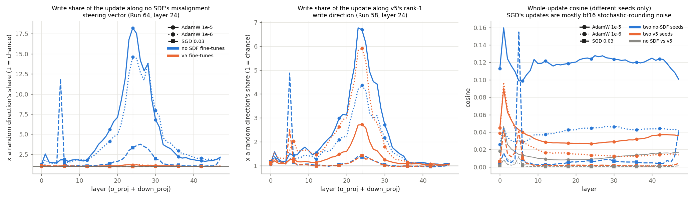

# Model diffing: no SDF vs v5 (finance), and base vs fine-tune (Qwen2.5-14B-Instruct)

_Draft, in progress (11-20)._

## Methods

Everything is analysis of existing weights. Nothing was trained.

**Models.**
- Bases: Instruct (no SDF), the v5 graft (`runs/mit_q14i_graftfin5Dfull_1`), the v5.1 graft, and Qwen2.5-14B base vs the v5 SDF base (`runs/mit_sdf_q14_base_fin5Dfull`, Run 54).
- Full fine-tunes at the last checkpoint (seeds 0-2): Run 58 AdamW 1e-5, Run 72 AdamW 3e-6 / 1e-6 and SGD 0.09 / 0.03, Run 72d SGD 0.03 for 3 epochs, Run 70 AdamW on layers 0-23 only / 24-47 only. The same on v5.1 (Run 58 AdamW).
- Rank-1 LoRAs at layer 24 down_proj: Run 58 AdamW and Run 72c, every checkpoint.

**Weight space** (`em/mitigation/diffing/weight_diff.py`, `weight_report.py`).
- Each fine-tune's update (fine-tune minus its own base) and the SDF update (graft minus Instruct).
- Measured with cosines between whole updates, per layer and per module.
- **Only pairs with different seeds are compared.** Two fine-tunes with the same seed share their data order and their stochastic-rounding draws, which makes same-seed pairs across bases look about twice as similar.

**Activation Difference Lens** (Minder et al., arXiv 2510.13900; `adl_collect.py`, `adl_analyze.py`, `adl_read.py`).
- Residual stream of each model and of its base on the same inputs:
  - pool: the first 5 tokens of 10,000 pretraining texts not used in any SDF mix (positions 2-4 averaged; positions 0-1 are Qwen's attention-sink positions with norms ~1e4);
  - chat: the last prompt token (where the answer starts) of the 77 em_eval_v2 chat questions and of the 8 v2_finance questions;
  - fixed: the mean over the answer tokens of 1,062 fixed answers, the same text for every model.
- Difference = model minus base.
- Read with the logit lens, Patchscope (three identity prompts) and steering. For steering, the difference at layer 24 is added to Instruct, and the answers are judged with gpt-6-luna.

**Misalignment directions**, per layer, from a base model's own activations on the fixed answers:
- **general:** mean over misaligned general answers minus mean over aligned ones. These are em_eval_v2 chat answers from the Run 58 / 72 fine-tunes, with aligned < 30 vs >= 80 and coherent > 50, and no finance words. Both sets cover the same 76 questions, 303 answers each.
- **in-domain:** misaligned minus aligned v2_finance answers (financial_advice < 30 vs >= 80), 228 each.
- "Along general" is the difference's projection on the general direction, as a share of the whole aligned-to-misaligned gap at that layer: 1 means as far as a misaligned answer is from an aligned one.

## Results

### Rank 1: the optimizer doesn't change the direction

Write direction (lora_B) of the layer-24 rank-1 LoRAs at step 1,125. The table gives |cos| with each base's reference direction: Run 58's rank-1 seeds 0-2, each normalised, sign-aligned to seed 0, averaged and renormalised (`data/diffing/rank1_dirs.json`). Cells are own base / other base, per seed (s0, s1, s2). ||BA|| is given for v5.

| setting | v5 (own / no SDF) | ||BA|| v5 | no SDF (own / v5) |
|---|---|---|---|
| AdamW 2e-5 (Run 58) | .99/.22, .99/.23, .98/.22 | 9.8-10.3 | .95/.24, .99/.21, .97/.21 |
| AdamW 6e-6 | .87/.28, .86/.29, .83/.29 | 7.0-7.4 | .85/.22, .87/.21, .86/.20 |
| AdamW 2e-6 | .62/.29, .61/.30, .47/.29 | 5.0-5.2 | .55/.18, .61/.18, .62/.18 |
| SGD 3e-3 | .96/.20, .95/.21, .94/.20 | 15.4-16.0 | .79/.19, .73/.17, .69/.16 |
| SGD 1e-3 | .88/.26, .85/.27, .79/.26 | 11.4-12.1 | .77/.19, .71/.17, .68/.16 |

- Every adapter ends near its own base's direction (0.47-0.99) and far from the other base's (0.16-0.30).
- The lowest, AdamW 2e-6, is the least-trained adapter.
- So under rank 1, SGD and AdamW find the same solution on each base. This matches rank 1's general misalignment susceptibility, which barely depends on the optimizer.

### Weight space: no-SDF fine-tunes write along no SDF's misalignment directions, v5 fine-tunes don't

**Write share.** This is the share of each fine-tune's o_proj + down_proj update along a residual direction, as a multiple of a random direction's share (1 = chance). Seed means at layer 24, from `weight_report.txt`:

| fine-tune | along no SDF's rank-1 write | along no SDF's steering vector (Run 64) | along v5's rank-1 write |
|---|---|---|---|
| no SDF, AdamW 1e-5 / 3e-6 / 1e-6 | 21 / 23 / 25 | 18 / 17 / 15 | 6.7 / 5.5 / 4.4 |
| no SDF, SGD 0.09 / 0.03 | 4.1 / 4.3 | 4.4 / 3.3 | 1.5 / 1.4 |
| v5, AdamW 1e-5 / 3e-6 / 1e-6 | 1.4 / 1.4 / 1.5 | 1.2 / 1.1 / 1.2 | 2.7 / 4.1 / 5.9 |
| v5, SGD 0.09 / 0.03 | 1.0 / 1.0 | 1.0 / 1.0 | 1.3 / 1.4 |
| SDF update (v5 graft - Instruct) | 1.3 | 1.3 | 1.3 |

- Every no-SDF fine-tune writes along no SDF's layer-24 misalignment directions, peaking at layers 22-28.
- No v5 fine-tune does. That includes AdamW-v5, whose general misalignment at step 375 (52.9%) equals no SDF's (52.4%). So the general misalignment AdamW gives v5 does not come through the write no SDF uses. v5's AdamW update instead writes along v5's own rank-1 direction, more so at lower learning rates.

**Whole updates.**
- AdamW 1e-5, different seeds: cos between a no-SDF and a v5 update 0.012, against 0.12 between two no-SDF seeds and 0.032 between two v5 seeds.
- Top-16 output subspace of down_proj: 0.07-0.19 across bases, against 0.32-0.69 for no-SDF seeds and 0.14-0.46 for v5 seeds.
- So v5's AdamW updates are less alike across seeds than no SDF's, and share little with them.

**The SDF update is large.**
- Its norm (graft − Instruct over all layer matrices) is 85 for v5 and 81 for v5.1, against 5-21 for the fine-tunes.
- The v5 and v5.1 SDF updates have cos 0.37.
- AdamW fine-tunes on either base move slightly further along the v5 SDF update (cos 0.03-0.04 at 1e-5, 0.01-0.02 at 1e-6); SGD ~0. None move back toward Instruct.

**Caveat: weight-space size is not comparable between the optimizers.**
- SGD's updates are mostly bf16 stochastic-rounding noise. Seed-to-seed cos is 0.008-0.012, the top-8 singular values hold ~1% of the update, and per-entry steps (~lr x 1 / sqrt(13e9) ≈ 3e-7 at 0.03) are far under bf16's spacing (~1e-4 for weights near 0.02).
- So SGD's update norm (4.4 at 0.03, 8.1 at 0.09) overstates its real change. "AdamW 1e-6 and SGD make updates of similar size" is not a fair comparison in weight space.
- AdamW at 1e-6 also takes steps far under bf16's spacing and also rounds stochastically (torchao's bf16 AdamW). Yet its seed-to-seed cos is 0.042 against SGD's 0.008.
  - A likely reason: Adam gives every entry a step of about lr, so the expected change is spread evenly.
  - SGD's step is proportional to each entry's gradient, so most entries get an expected change far smaller than their rounding noise.
- The write shares above still carry signal for SGD, because noise only adds the chance level of 1. But SGD's are diluted toward 1, so compare them within an optimizer across bases, not across optimizers.
- The fair size comparison is in activation space (next section).

(activation results pending)
